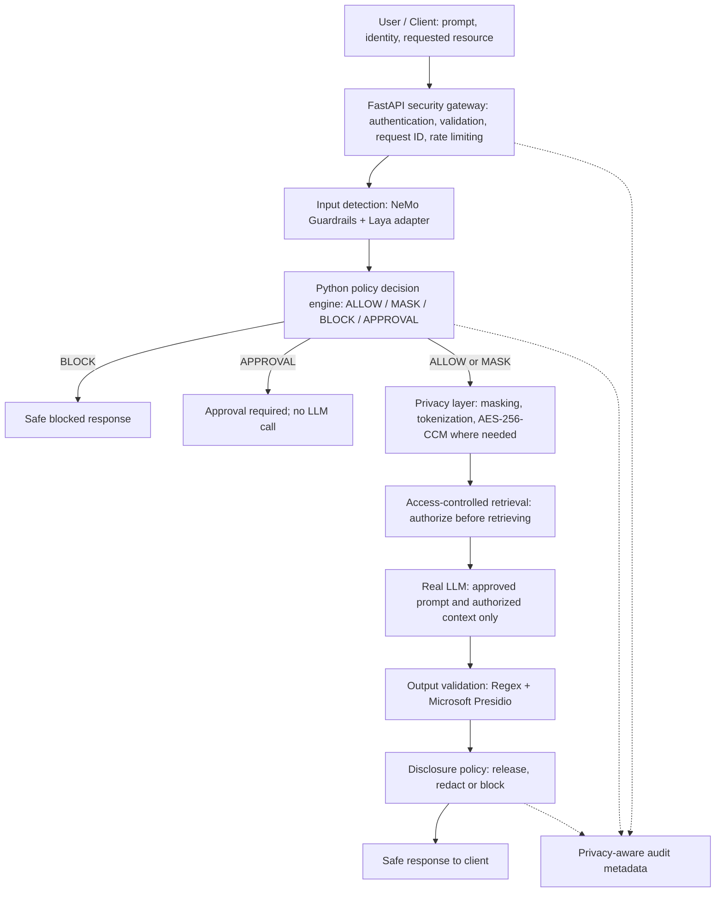

# AEGIS AI — Backend Architecture

> Version: 2.1 — aligned to `ChatGPT-Backend Building Guide-20261015-1806.md` (15 October 2026).
> Scope: **backend only**. This document supersedes the feature set in the earlier `Architecture(1).md`. It does not add functionality absent from the finalized backend guide.

## 1. Purpose and architectural rules

AEGIS AI is a Python security gateway designed to detect and prevent data leakage through AI models. Its backend independently performs input inspection, policy enforcement, privacy transformations, access-controlled retrieval, output validation and minimal audit logging.

- Authenticate and validate requests before processing.
- Never give an LLM unauthorized retrieved content.
- Never let a classifier override an explicit authorization denial.
- Do not send a request to the real LLM until required input checks and policy enforcement have passed.
- Keep cryptographic keys and sensitive plaintext out of logs.
- Fail closed when a security-critical check cannot complete.
- Keep individual modules independently testable.

## 2. End-to-end processing architecture



Retrieval is conditional on the request requiring protected documents; the LLM receives only authorized context. Output validation occurs before any generated text is returned to the user.

## 3. Components and responsibilities

| Component | Technology | Responsibility |
|---|---|---|
| API gateway | Python 3.11 + FastAPI | Requests, authentication, validation, request IDs and rate limiting |
| Input guardrails | NeMo Guardrails | Configured input rules and jailbreak safeguards |
| Input classifier | Laya model adapter | Classification according to the model's verified capabilities; return risk signals |
| Policy decision engine | Python | Combine detector signals, verified identity, resource permissions and policies; choose ALLOW, MASK, BLOCK or APPROVAL |
| Privacy transformations | Python | Masking, redaction and tokenization of permitted sensitive spans |
| Confidential-data encryption | AES-256-CCM | Authenticated encryption of recoverable confidential data, with protected key management |
| Password verification, if local auth is used | Argon2id | Store and verify password hashes |
| Integrity or pseudonymous identifiers, when required | SHA-256 / HMAC-SHA-256 | Integrity fingerprints or keyed identifiers, not a substitute for encryption |
| Access-controlled retrieval | Python service | Enforce permissions before retrieving documents and before disclosing protected content |
| Real LLM connector | Provider adapter | Submit approved input and authorized context, return generated text for validation |
| Output regex detection | Regex | Recognize defined PII or secret patterns |
| Output PII detection | Microsoft Presidio | Detect PII entity types and text spans |
| Final enforcement | Python | Apply output disclosure policy; redact, block or release |
| Persistence | PostgreSQL + SQLAlchemy | Policies, resource-access mappings and minimal audit metadata; SQLite is optional for local prototyping |
| Tests | Pytest + HTTPX | Module tests, integration tests and security evaluation |

NeMo and Laya are the **input** detection components. Regex and Presidio are the dedicated **output** validation components. The access-control check and encryption service are separate boundaries, not substitutes for detection.

## 4. Request lifecycle

1. FastAPI validates the request, resolves authenticated identity, generates a request ID and applies rate limits.
2. NeMo Guardrails inspects the incoming prompt using configured input safeguards.
3. The Laya adapter classifies the request using its verified interface. Its model identifier, input/output format, labels and inference location must be confirmed before implementation.
4. The Python policy engine combines detection signals, resource authorization and application rules. Decisions are **ALLOW**, **MASK**, **BLOCK** and **APPROVAL**. Authorization denial always takes precedence. The guide's illustrative `REVIEW` result is treated here as an unresolved naming inconsistency; implement one consistent approval/review state after confirming its semantics.
5. If blocked, return a safe refusal; if approval is required, do not call the LLM until approval is granted. The finalized guide does not specify approval storage or workflow UI, so those details remain undecided.
6. For approved processing, mask, redact or tokenize sensitive spans according to policy. Encrypt recoverable confidential data with AES-256-CCM where storage is needed.
7. If retrieval is requested, verify permissions **before** obtaining protected documents; supply only authorized content to the LLM.
8. The LLM connector sends the approved prompt and authorized context to the configured real model.
9. Run Regex and Presidio against the generated answer, combine overlapping detections, and apply the response disclosure policy.
10. Return only the validated response and record minimal privacy-safe audit metadata.

## 5. Input inspection contracts

### NeMo Guardrails

Configure input rails for project-relevant jailbreak attempts and requests to extract protected information. Keep `guardrails/config.yml` version-controlled and test legitimate and adversarial prompts. The installed NeMo version and configuration syntax must be verified.

Conceptual adapter interface:

```python
def inspect_input(prompt: str) -> dict:
    # Return structured allow/risk/reason information.
    ...
```

### Laya

Laya is an **input classifier** in the finalized guide. Before integration, verify its repository or API, task, labels, input shape, confidence/span support, local-versus-remote serving and hardware requirements. Do not assume particular labels or scores. Standardize its results through `app/detection/laya_adapter.py`. Evaluate overlap with NeMo rather than duplicating every classification call automatically.

## 6. Policy enforcement

`app/services/policy_engine.py` receives verified identity and permissions, NeMo findings and Laya risk signals. It returns one enforceable action: `ALLOW`, `MASK`, `BLOCK` or `APPROVAL`.

- Explicitly denied document access always yields `BLOCK`.
- A failed security-critical inspection must not result in an automatic `ALLOW`.
- Define how ambiguous results, detector disagreement, sensitive-but-permitted content and approvals are handled before implementation.
- Do not infer permissions from user-supplied prompt text.

The finalized guide contains only illustrative policy pseudocode, not a complete policy matrix; thresholds and category-specific rules remain to be specified.

## 7. Privacy and cryptography

- Implement deterministic masking and tokenization with correct sensitive-text offsets.
- Use typed placeholders such as `[PHONE_1]` when permitted by policy.
- For confidential data that must be recoverable, use **AES-256-CCM** with a protected 256-bit key, fresh nonce per encryption, authenticated tag, key identifier and authenticated decryption. Reject tampered ciphertext.
- Never log raw values, cryptographic keys or restored plaintext.
- Use **Argon2id** only if passwords are managed locally. An external identity provider may handle passwords instead.
- Use **SHA-256** for suitable integrity fingerprints and **HMAC-SHA-256** for keyed pseudonymous identifiers when needed.

The guide does not finalize a token-vault database schema, retention policy or automatic token restoration. Do not implement those as required features without a later decision.

## 8. Protected retrieval and LLM access

`app/services/access_control.py` checks trusted user identity and resource metadata. Permissions may depend on role, department, classification and explicit access mappings; exact rules must be specified from the access-control data and project policy. Deny by default. Check before retrieval and again before disclosure.

`app/services/llm_gateway.py` accepts only the approved prompt and authorized context. It does not bypass policy and does not log raw prompts or responses by default. The real model/provider is not fixed by the guide.

## 9. Output validation

`app/detection/output_regex.py` checks explicit secret/identifier patterns. `app/detection/output_presidio.py` identifies PII entity types, offsets and scores. Combine and deduplicate overlapping findings, check disclosure permissions and redact or block prohibited disclosures. Only validated text is returned to the client.

Test Indian identifiers, non-English content and project-specific secrets explicitly; do not assume the default English Presidio recognizers cover them.

## 10. Authentication, persistence and audit

Use verified sessions or tokens to identify callers. Validate incoming requests and apply rate limits at the gateway. Use PostgreSQL and SQLAlchemy for policies, access mappings and minimal audit metadata (SQLite is an optional prototype alternative).

Audit only: request ID and timestamp; permitted pseudonymous/authenticated user identifier; detector and model versions; decision and reason code; released/masked/blocked outcome; latency and error category. Restrict audit access and define retention. Never store raw prompts, unredacted outputs, passwords or encryption keys in audit records.

## 11. API scope

The finalized guide specifies the following initial endpoints:

| Method | Endpoint | Purpose |
|---|---|---|
| `GET` | `/health` | Basic gateway health |
| `POST` | `/v1/chat` | Authenticated prompt through the complete security pipeline |

The `/v1/chat` implementation begins as a validated placeholder and is connected stage by stage. Additional administration, document, approval, policy, dashboard and evaluation endpoints are **not specified** in the finalized guide and must not be treated as committed scope.

## 12. Target backend repository layout

```text
data-leakage-gateway/
├── app/
│   ├── main.py
│   ├── api/
│   │   ├── routes.py
│   │   └── dependencies.py
│   ├── core/
│   │   ├── config.py
│   │   └── security.py
│   ├── detection/
│   │   ├── input_guardrails.py
│   │   ├── laya_adapter.py
│   │   ├── output_regex.py
│   │   └── output_presidio.py
│   ├── services/
│   │   ├── policy_engine.py
│   │   ├── access_control.py
│   │   ├── redaction.py
│   │   ├── encryption.py
│   │   ├── llm_gateway.py
│   │   └── audit.py
│   ├── schemas/
│   │   └── requests.py
│   └── db/
│       ├── models.py
│       └── session.py
├── guardrails/
│   └── config.yml
├── datasets/
├── tests/
│   ├── test_input_detection.py
│   ├── test_output_validation.py
│   ├── test_access_control.py
│   ├── test_encryption.py
│   └── test_gateway.py
├── .env.example
├── .gitignore
└── requirements.txt
```

## 13. Backend implementation sequence

1. **Foundation:** Python 3.11 virtual environment; FastAPI `/health` and placeholder `/v1/chat`; request validation.
2. **Input guardrails:** NeMo configuration and positive/adversarial tests.
3. **Laya adapter:** verify the model and integrate its actual inference interface; test overlap and failure handling.
4. **Policy engine:** identity-aware and authorization-aware ALLOW/MASK/BLOCK/APPROVAL rules.
5. **Privacy layer:** masking, tokenization, AES-256-CCM authenticated encryption; Argon2id only if local passwords are required.
6. **Access control:** authorize protected documents before retrieval and disclosure.
7. **Real LLM:** connect an approved prompt/context-only adapter.
8. **Output validation:** Regex + Presidio, deduplication, disclosure-policy enforcement.
9. **Audit:** minimal metadata, privacy-safe logging and access restrictions.
10. **Integration:** orchestrate the full pipeline; fail closed on security-critical failures.
11. **Evaluation:** verify all required scenarios and measure accuracy and latency.

## 14. Required security tests

| Scenario | Expected behavior |
|---|---|
| Sensitive PII supplied accidentally | Detect and mask or block according to policy |
| Prompt-injection attempt to reveal protected information | Flag or block input; also inspect any generated output |
| Unauthorized protected-document request | Deny retrieval; never send the document to the LLM |
| Legitimate non-sensitive prompt | Allow when policy and authorization permit |
| Detector or other security-critical failure | Apply documented fail-closed behavior |

Evaluate at least **30 labelled legitimate and adversarial prompts**, plus separate output-validation tests. Report precision, recall, F1, false-positive rate, unauthorized-disclosure rate and latency. Increase evaluation size if the available data permits.

## 15. Unresolved prerequisites (do not invent)

- Exact Laya model repository/API, task and inference contract.
- Input and output dataset schemas, including any access-control CSV.
- Real LLM provider and deployment details.
- Actual role/resource permission matrix and policy thresholds.
- Approval workflow semantics and whether it will be implemented in the first backend iteration.
- Storage and lifetime rules for tokenization mappings, if reversible tokens are required.
- Tested dependency versions for NeMo Guardrails, Laya and Presidio.

These are **open decisions**, not authorization to add features. Implement only what the finalized guide defines and what is subsequently confirmed.

### Implementation status — 2026-10-15 Studio audit

The user explicitly authorized repair of the existing frontend around this backend scope. `backend/approved_pipeline.py` now provides fail-closed orchestration at `/v1/chat`, `/api/chat` and the existing Studio wrapper `/api/demos/run`. NeMo/Presidio adapters follow documented local APIs, but the packages/config/model are absent in the observed runtime; Laya's exact identity and inference contract remain unresolved, so its adapter reports unavailable rather than making predictions. No LLaMA or replacement input model was added. Default requests cannot silently use legacy regex or the offline provider as a live pipeline.

SQL permission filtering precedes protected retrieval and is checked before disclosure. Python policy uses ALLOW/MASK/BLOCK/APPROVAL; APPROVAL prevents generation but has no new queue/workflow. Request-local masking/tokenization and the independent AES-256-CCM primitive are tested; existing SQLite contents were not encrypted. Regex output plus Presidio is an adapter boundary requiring actual local model installation. Runtime stages share `auth`, `authorization`, `nemo_input`, `laya_input`, `policy`, `privacy`, `retrieval`, `llm`, `output_regex`, `output_presidio` receipt names. Stages report work actually completed, not planned work.

AD-13: the separately labelled legacy path remains only for explicit offline regression (`AEGIS_PIPELINE=legacy`, development/demo mode, mock provider); the Studio never executes it. Legacy approval execution is guarded the same way. Synthetic demo login is disabled in production; administrator-only demo switching creates a new lower-privilege verified session and revokes the old token. Production identity integration remains unimplemented.

Full pipeline status is **incomplete**. Automated tests with explicit doubles validate orchestration, not the behavior of absent model packages. See `../STUDIO-AUDIT.md`, `../STUDIO-GUIDE.md` and memory for measured results and missing prerequisites.

## 16. Explicitly out of scope

No frontend, React dashboard, Scenario Lab, SSE incident feed, incident analytics, canary-based leak detection, system-prompt similarity engine, restricted-chunk fingerprints, shadow-match vector search, dedicated custom input regex/entropy detector suite, custom normalizer, hash-chained audit system, automatic token restoration, or extra administration endpoints. These existed in the older architecture but are not part of the finalized backend guide.
